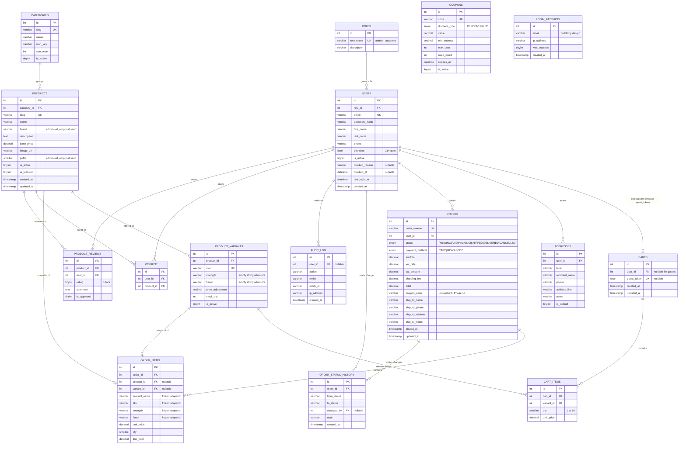

# Vape Shop — Database, Auth, Admin Panel & Design Polish

Date: 2026-10-22
Status: Plan — **revision 2**, awaiting approval before any code is written
Supersedes nothing. `docs/superpowers/specs/2026-10-19-vape-shop-frontend-design.md` remains the
source of truth for the **visual language** (neon/cyber, tokens, breakpoints). This plan adds a
backend and says exactly where the frontend must change to accommodate it.

> **Revision 2 changelog.** Revision 1 was reviewed against this machine's actual XAMPP
> (Apache + MariaDB 10.4.32 + PHP 8.2.12) and the DDL was executed against a real MariaDB
> instance. The SQL is confirmed to run clean — 16 tables, 15 foreign keys, every `UNIQUE` and
> `CHECK` firing as intended. The API contract and Phases 2–5 were rewritten around 12 blockers
> found in review (guest-token loss on session regeneration, no route to a `variantId`, no CSRF
> delivery to the client, the disabled `intl` extension, phase-ordering violations, and a
> two-auth-designs contradiction). All of them are fixed below and marked **[R2]** so you can see
> what changed.

---

## 0. Where the project stands today

Read this first, because the plan is built on top of it.

| Layer | Current state | Consequence |
|---|---|---|
| `index.php` | Full markup shell, one page, SVG icon sprite, age gate, cart drawer, quick-view, checkout mount points | Markup is fine. Needs a PHP session bootstrap and a shared `<head>` so new pages match. |
| `app.js` | 1,100 lines. Vanilla. `fetch('products.json')` → catalog. Cart in `localStorage['cart_v1']`. 4-step checkout fully client-side with simulated submit. | The **cart and checkout must be rewritten** to talk to the server. Everything else survives. |
| `style.css` | 32 KB. Token-based, 14 commented sections, mobile-first with explicit breakpoints. | Reuse the token block verbatim. Add new sections rather than rewriting. |
| `products.json` | 40 products, 6 categories, invented PH-market names and prices (actual range **₱299–₱4,499**). Fields are exactly `id, category, name, description, price, image, strength, strengths, flavors, featured` — **there is no `brand` and no `puffs` field.** | Becomes the **seed source** for the database. `brand` and `puffs` are admin-only columns that start empty. |
| Backend | **None.** No DB, no PHP beyond the static shell, no sessions. | Everything in Phases 0–2 is greenfield. |

**The single most important structural fact:** the frontend was deliberately built with a normalizer
behind one function (`normalizeProduct()` in `app.js`) and the spec promised *"a future
`fetch('/api/products')` replaces it with a one-line change."* That promise holds for the catalog.
The cart swap does not, and it is the expensive part of this project — Phase 4 spends real effort
on it.

---

## 1. Decisions locked with the requester (2026-10-22)

| Question | Answer | Effect on the plan |
|---|---|---|
| Stack | MySQL + PHP on XAMPP (via phpMyAdmin) | PDO, no framework, no Composer, no build step — consistent with the existing vanilla codebase |
| Admin scope | Product management, order management, customer list, dashboard stats | Phase 7 delivers all four |
| Cart location | Server-side, in the database | Phase 4 |
| Checkout | **Login required** before checkout | Phase 5 — adds an auth gate to the existing 4-step flow |
| Visual direction | Keep the neon/cyber identity, but polish it | Phase 8 — no redesign, an upgrade |
| Report | Needs an ERD / database diagram | §4 ships a Mermaid ERD plus a plain-English entity list you can paste straight into the write-up |

### Builder's calls (settled here, not asked)

1. **PDO, not MySQLi.** PDO is PHP's "one safe way to talk to MySQL." It is object-based, supports
   **prepared statements** (you send the SQL and the values separately, so a value can never become
   SQL — this kills SQL injection in one step), and it is the same interface on every database.
   MySQLi is the older procedural style; it is not wrong, but PDO is less code and harder to misuse.
   *Plain-English line for the report:* "The application uses PDO with prepared statements to
   prevent SQL injection."
2. **Guests can browse and fill a cart; only checkout requires an account.** A `carts` row can
   belong to a guest (keyed by a session token) or to a user. On login, the guest cart merges into
   the user's cart. Forcing a login to *add to cart* would hurt the store more than it helps.
3. **`password_hash()` / `password_verify()` only** — never store or compare raw passwords.
4. **The age gate gets a server-side twin.** Registration requires a date of birth and the server
   rejects anyone under 21. The existing `localStorage` age gate stays for guests. **[R2]** The age
   is also re-checked at login, because `birthdate` can be edited in the database after signup.
5. **Money is `DECIMAL(10,2)`** in the database, never `FLOAT`.
6. **Product variants are real SKUs.** A `product_variants` row = one sellable combination
   (product + strength + flavor + stock + price adjustment). A cart line points at a variant, not
   at a loose string, so stock and price can never drift.
7. **SQLite / ORM / migration tooling: not used.** Not needed at this scale, and it would add a
   dependency the existing codebase does not have.
8. **Shop name stays "VAPE CO."** It is a placeholder; renaming is one constant in `config.php`
   plus a find-and-replace. Do not spend effort on it.
9. **Payments stay simulated.** The chosen method is recorded on the order; no card data is ever
   collected or stored.
10. **The server is the only place money is calculated.** The client's `computeTotals()`,
    `VAT_RATE`, `FLAT_SHIPPING`, and `FREE_SHIPPING_ABOVE` are deleted in Phase 4. The server
    returns the totals block, and the client renders it verbatim. **[R2]** This was ambiguous in
    revision 1 and would have let the drawer and the receipt disagree by 12%.
11. **Free shipping is measured on the pre-VAT subtotal**, above ₱2,000 — the exact rule the
    existing `app.js` uses today, so switching to the server does not change what a customer sees.
12. **Three "stretch" tables** (coupons, wishlist, reviews) ship in the schema but their UI is
    Phase 10. **[R2]** Revision 1 had the wishlist heart in Phase 8 and the rest deferred; that
    contradiction is gone.
13. **MariaDB vs MySQL:** XAMPP ships **MariaDB**. The schema is written to run identically on both.
    The one behavioural difference that matters (ENUM case-sensitivity) is handled by an explicit
    mapping in code, not by relying on either database's behaviour. See §4.4.
14. **Guest carts are never garbage-collected.** That is a known gap, called out in Phase 7.

---

## 2. What "PDO" means in practice (read this if you have never used it)

You will see four lines of PHP that do all the database work:

```php
// config/database.php
function db(): PDO {
    static $pdo = null;
    if ($pdo === null) {
        $pdo = new PDO(
            'mysql:host=localhost;dbname=vape_shop;charset=utf8mb4',
            'root',            // XAMPP default user
            '',                // XAMPP default: empty password
            [
                PDO::ATTR_ERRMODE            => PDO::ERRMODE_EXCEPTION, // errors throw, they don't print
                PDO::ATTR_DEFAULT_FETCH_MODE => PDO::FETCH_ASSOC,       // rows come back as ['col' => value]
                PDO::ATTR_EMULATE_PREPARES   => false,                  // real prepared statements
                PDO::MYSQL_ATTR_INIT_COMMAND  => "SET time_zone='+08:00'", // PH time, see §4.4
            ]
        );
    }
    return $pdo;
}
```

Then every query in the app looks like this — **notice there is no string concatenation anywhere**:

```php
// GOOD — the value is sent separately, so it can never be read as SQL
$stmt = db()->prepare('SELECT * FROM users WHERE email = ?');
$stmt->execute([$email]);
$user = $stmt->fetch();

// BAD — never do this
$user = db()->query("SELECT * FROM users WHERE email = '$email'");
```

That is the whole idea. Every Phase in this plan uses the good form.

**[R2] Three things that will bite you if you skip them**

- **`db()` needs a try/catch.** If MySQL is not running, `new PDO(...)` throws and the page dies
  with a stack trace. Wrap the connection and show a friendly "database unreachable" message.
  MySQL being switched off is the single most likely first-week failure.
- **Include paths must be absolute.** `require 'includes/auth.php'` resolves against the current
  working directory, which differs under Apache, the CLI, and phpMyAdmin. Always use
  `require_once __DIR__ . '/../includes/auth.php';` — or define a `BASE_PATH` constant once.
- **`api/*.php` files need the session bootstrap too.** They are not "pages", but they still need
  `session_start()` and `current_user()`.

---

## 3. Environment setup

Do this first — everything depends on it. **≈30 minutes.**

1. Start **Apache** and **MySQL** in the XAMPP Control Panel.
2. Confirm your project URL: `http://localhost/Cristobal_webprog/Vape_ShopWEb/`
3. **Enable the `intl` extension.** This is the one that bites. Open
   `C:\xampp\php\php.ini`, find the line `;extension=intl` (around line 934), and delete the
   leading semicolon:
   ```ini
   extension=intl
   ```
   The DLL and its ICU dependencies are already installed — you are only uncommenting the line.
   Restart Apache, then verify:
   ```powershell
   C:\xampp\php\php.exe -m | Select-String intl
   ```
   `intl` must appear in the output. If it does not, the fallback `money()` in §5 still formats
   prices correctly — but `Intl` is nicer, and the browser-side formatter is unaffected either way.
4. Check the PHP version: `C:\xampp\php\php.exe -v`. This plan needs **PHP 7.4+** (you have 8.2).
5. Confirm the database server flavour:
   ```powershell
   C:\xampp\mysql\bin\mysql.exe -u root -e "SELECT VERSION();"
   ```
   MariaDB 10.4 is expected and fully supported.
6. `date_default_timezone_set('Asia/Manila')` goes in `config/config.php`, **before**
   `session_start()`, so the session cookie flags can also be set there.

> **Creating the database itself is Phase 1, not setup.** The `schema.sql` file does not exist yet.
> The instruction is at the end of Phase 1.

---

## 4. Database schema

### 4.1 Entity list in plain English (paste this into the report)

| Table | One row = | Why it exists |
|---|---|---|
| `roles` | One kind of account (`admin`, `customer`) | Separates the two account types; adding a `staff` role later is a one-row insert |
| `users` | One registered person | Holds login credentials, name, phone, birthdate, role, active flag, and the block reason |
| `categories` | One product category | Replaces the hard-coded `CATEGORIES` array in `app.js` so the admin can rename a category |
| `products` | One product | The catalog row: name, description, base price, image, featured flag |
| `product_variants` | One sellable SKU (a product at one strength + flavor) | Holds the real stock count and any price adjustment |
| `carts` | One shopping cart | Belongs to a logged-in user **or** to a guest session |
| `cart_items` | One line in a cart | Points at a variant, snapshots its price, holds the quantity |
| `addresses` | One saved delivery address | Lets a customer reorder without retyping |
| `orders` | One placed order | Totals, status, payment method, and a snapshot of where it ships |
| `order_items` | One line in an order | Frozen copy of the product name/price at purchase time, so later price or rename changes never rewrite history |
| `order_status_history` | One status change on an order | Audit trail + the customer-facing order timeline |
| `coupons` | One discount code | *Phase 10 (stretch)* — schema now, UI later |
| `wishlist` | One saved product for one customer | *Phase 10 (stretch)* |
| `product_reviews` | One review of one product by one customer | *Phase 10 (stretch)* |
| `audit_log` | One admin action | Who changed what, and when |
| `login_attempts` | One sign-in attempt | Powers the brute-force lockout |

**13 core tables** (everything except `coupons`, `wishlist`, `product_reviews`).
`login_attempts` deliberately has **no** foreign key — attempts are recorded even for email
addresses that do not exist, which is exactly what makes brute-force detection work.

### 4.2 ERD (Mermaid — paste into a Mermaid renderer or GitHub to get your diagram)

This ERD matches the DDL in §4.3 exactly. **[R2]** Revision 1 claimed two relationships that the
DDL did not create; those are corrected here.



> **Getting a picture for your report:** paste the Mermaid block into
> [mermaid.live](https://mermaid.live) → it renders → "PNG" → download → drop into the document.
> The same block renders natively on GitHub, GitLab, and Notion.

### 4.3 The DDL (this is literally the file `database/schema.sql`)

Write every table with `ENGINE=InnoDB` and `utf8mb4` — InnoDB gives you real foreign keys and
transactions, and `utf8mb4` handles emoji and ₱ correctly.

**[R2] Three schema changes from revision 1, each with a reason:**

| Change | Why |
|---|---|
| `users.blocked_reason` + `users.blocked_at` added | Task 7.6 promised to show a blocked customer *why* — there was nowhere to store it. |
| `product_variants.strength` / `.flavor` are `NOT NULL DEFAULT ''` instead of `NULL`, plus `UNIQUE (product_id, strength, flavor)` | MySQL treats `NULL` as distinct from `NULL` in a `UNIQUE` index, so two "no strength, no flavor" rows for one product would both be allowed — and "Generate from options" run twice would create duplicates. Empty strings make the uniqueness rule actually work. |
| `fk_cart_items_variant` gained `ON DELETE CASCADE` | Without it, a product that any cart has ever referenced **cannot be deleted** — MySQL error 1451. Cart lines are transient, so cascading is safe. |

```sql
CREATE DATABASE IF NOT EXISTS vape_shop
  CHARACTER SET utf8mb4 COLLATE utf8mb4_unicode_ci;
USE vape_shop;

-- ---------------------------------------------------------------- roles
CREATE TABLE roles (
  id          TINYINT UNSIGNED AUTO_INCREMENT PRIMARY KEY,
  role_name   VARCHAR(20)  NOT NULL UNIQUE,
  description VARCHAR(120) NOT NULL DEFAULT '',
  created_at  TIMESTAMP NOT NULL DEFAULT CURRENT_TIMESTAMP
) ENGINE=InnoDB;

INSERT INTO roles (role_name, description) VALUES
  ('admin',    'Full access to the admin panel'),
  ('customer', 'Shopper account: cart, orders, reviews');

-- ---------------------------------------------------------------- users
CREATE TABLE users (
  id            INT UNSIGNED AUTO_INCREMENT PRIMARY KEY,
  role_id       TINYINT UNSIGNED NOT NULL,
  email         VARCHAR(190) NOT NULL UNIQUE,
  password_hash VARCHAR(255) NOT NULL,
  first_name    VARCHAR(60)  NOT NULL,
  last_name     VARCHAR(60)  NOT NULL,
  phone         VARCHAR(20)  DEFAULT NULL,
  birthdate     DATE NOT NULL,
  is_active     TINYINT(1) NOT NULL DEFAULT 1,
  blocked_reason VARCHAR(255) DEFAULT NULL,
  blocked_at    DATETIME DEFAULT NULL,
  last_login_at DATETIME DEFAULT NULL,
  created_at    TIMESTAMP NOT NULL DEFAULT CURRENT_TIMESTAMP,
  updated_at    TIMESTAMP NOT NULL DEFAULT CURRENT_TIMESTAMP ON UPDATE CURRENT_TIMESTAMP,
  CONSTRAINT fk_users_role FOREIGN KEY (role_id) REFERENCES roles(id),
  INDEX idx_users_role (role_id),
  INDEX idx_users_active (is_active)
) ENGINE=InnoDB;

-- ---------------------------------------------------------------- categories
CREATE TABLE categories (
  id         TINYINT UNSIGNED AUTO_INCREMENT PRIMARY KEY,
  slug       VARCHAR(40) NOT NULL UNIQUE,
  name       VARCHAR(60) NOT NULL,
  icon_key   VARCHAR(40) DEFAULT NULL,
  sort_order TINYINT NOT NULL DEFAULT 0,
  is_active  TINYINT(1) NOT NULL DEFAULT 1
) ENGINE=InnoDB;

-- ---------------------------------------------------------------- products
CREATE TABLE products (
  id          INT UNSIGNED AUTO_INCREMENT PRIMARY KEY,
  category_id TINYINT UNSIGNED NOT NULL,
  slug        VARCHAR(140) NOT NULL UNIQUE,
  name        VARCHAR(140) NOT NULL,
  brand       VARCHAR(60)  DEFAULT NULL,
  description TEXT NOT NULL,
  base_price  DECIMAL(10,2) NOT NULL DEFAULT 0.00,
  image_url   VARCHAR(255) DEFAULT NULL,
  puffs       SMALLINT UNSIGNED DEFAULT NULL,
  is_active   TINYINT(1) NOT NULL DEFAULT 1,
  is_featured TINYINT(1) NOT NULL DEFAULT 0,
  created_at  TIMESTAMP NOT NULL DEFAULT CURRENT_TIMESTAMP,
  updated_at  TIMESTAMP NOT NULL DEFAULT CURRENT_TIMESTAMP ON UPDATE CURRENT_TIMESTAMP,
  CONSTRAINT fk_products_category FOREIGN KEY (category_id) REFERENCES categories(id),
  INDEX idx_products_category (category_id),
  INDEX idx_products_active_featured (is_active, is_featured),
  INDEX idx_products_name (name)
) ENGINE=InnoDB;

-- ---------------------------------------------------------------- variants (SKUs)
-- strength / flavor use '' (not NULL) so the UNIQUE key below actually works.
CREATE TABLE product_variants (
  id               INT UNSIGNED AUTO_INCREMENT PRIMARY KEY,
  product_id       INT UNSIGNED NOT NULL,
  sku              VARCHAR(40) NOT NULL UNIQUE,
  strength         VARCHAR(30) NOT NULL DEFAULT '',
  flavor           VARCHAR(60) NOT NULL DEFAULT '',
  price_adjustment DECIMAL(10,2) NOT NULL DEFAULT 0.00,
  stock_qty        INT NOT NULL DEFAULT 0,
  is_active        TINYINT(1) NOT NULL DEFAULT 1,
  CONSTRAINT fk_variants_product FOREIGN KEY (product_id) REFERENCES products(id) ON DELETE CASCADE,
  UNIQUE KEY uq_variant_combo (product_id, strength, flavor),
  INDEX idx_variants_stock (stock_qty)
) ENGINE=InnoDB;

-- ---------------------------------------------------------------- carts
-- user_id NULL  -> guest cart (keyed by guest_token)
-- guest_token NULL -> logged-in cart (keyed by user_id)
-- MySQL allows many NULLs in a UNIQUE index, so this holds both cases cleanly.
CREATE TABLE carts (
  id          INT UNSIGNED AUTO_INCREMENT PRIMARY KEY,
  user_id     INT UNSIGNED DEFAULT NULL,
  guest_token CHAR(64) DEFAULT NULL,
  created_at  TIMESTAMP NOT NULL DEFAULT CURRENT_TIMESTAMP,
  updated_at  TIMESTAMP NOT NULL DEFAULT CURRENT_TIMESTAMP ON UPDATE CURRENT_TIMESTAMP,
  CONSTRAINT fk_carts_user FOREIGN KEY (user_id) REFERENCES users(id) ON DELETE CASCADE,
  UNIQUE KEY uq_carts_user (user_id),
  UNIQUE KEY uq_carts_guest (guest_token)
) ENGINE=InnoDB;

-- ---------------------------------------------------------------- cart items
CREATE TABLE cart_items (
  id         INT UNSIGNED AUTO_INCREMENT PRIMARY KEY,
  cart_id    INT UNSIGNED NOT NULL,
  variant_id INT UNSIGNED NOT NULL,
  qty        SMALLINT UNSIGNED NOT NULL DEFAULT 1,
  unit_price DECIMAL(10,2) NOT NULL,
  created_at TIMESTAMP NOT NULL DEFAULT CURRENT_TIMESTAMP,
  CONSTRAINT fk_cart_items_cart    FOREIGN KEY (cart_id)    REFERENCES carts(id)            ON DELETE CASCADE,
  CONSTRAINT fk_cart_items_variant FOREIGN KEY (variant_id) REFERENCES product_variants(id)  ON DELETE CASCADE,
  UNIQUE KEY uq_cart_variant (cart_id, variant_id),
  CONSTRAINT chk_cart_items_qty CHECK (qty BETWEEN 1 AND 10)
) ENGINE=InnoDB;

-- ---------------------------------------------------------------- addresses
CREATE TABLE addresses (
  id             INT UNSIGNED AUTO_INCREMENT PRIMARY KEY,
  user_id        INT UNSIGNED NOT NULL,
  label          VARCHAR(40)  NOT NULL DEFAULT 'Home',
  recipient_name VARCHAR(120) NOT NULL,
  phone          VARCHAR(20)  NOT NULL,
  address_line   VARCHAR(255) NOT NULL,
  notes          VARCHAR(255) DEFAULT NULL,
  is_default     TINYINT(1) NOT NULL DEFAULT 0,
  created_at     TIMESTAMP NOT NULL DEFAULT CURRENT_TIMESTAMP,
  CONSTRAINT fk_addresses_user FOREIGN KEY (user_id) REFERENCES users(id) ON DELETE CASCADE,
  INDEX idx_addresses_user (user_id)
) ENGINE=InnoDB;

-- ---------------------------------------------------------------- orders
CREATE TABLE orders (
  id              INT UNSIGNED AUTO_INCREMENT PRIMARY KEY,
  order_number    VARCHAR(20) NOT NULL UNIQUE,
  user_id         INT UNSIGNED NOT NULL,
  status          ENUM('PENDING','PAID','PACKING','SHIPPED','DELIVERED','CANCELLED')
                    NOT NULL DEFAULT 'PENDING',
  payment_method  ENUM('CARD','GCASH','COD') NOT NULL,
  subtotal        DECIMAL(10,2) NOT NULL,
  vat_rate        DECIMAL(5,4) NOT NULL DEFAULT 0.1200,
  vat_amount      DECIMAL(10,2) NOT NULL,
  shipping_fee    DECIMAL(10,2) NOT NULL DEFAULT 0.00,
  total           DECIMAL(10,2) NOT NULL,
  coupon_code     VARCHAR(30) DEFAULT NULL,
  ship_to_name    VARCHAR(120) NOT NULL,
  ship_to_phone   VARCHAR(20)  NOT NULL,
  ship_to_address VARCHAR(255) NOT NULL,
  ship_to_notes   VARCHAR(255) DEFAULT NULL,
  placed_at       TIMESTAMP NOT NULL DEFAULT CURRENT_TIMESTAMP,
  updated_at      TIMESTAMP NOT NULL DEFAULT CURRENT_TIMESTAMP ON UPDATE CURRENT_TIMESTAMP,
  CONSTRAINT fk_orders_user FOREIGN KEY (user_id) REFERENCES users(id),
  INDEX idx_orders_user (user_id),
  INDEX idx_orders_status (status),
  INDEX idx_orders_placed (placed_at)
) ENGINE=InnoDB;

-- ---------------------------------------------------------------- order items (frozen snapshot)
CREATE TABLE order_items (
  id           INT UNSIGNED AUTO_INCREMENT PRIMARY KEY,
  order_id     INT UNSIGNED NOT NULL,
  product_id   INT UNSIGNED DEFAULT NULL,
  variant_id   INT UNSIGNED DEFAULT NULL,
  product_name VARCHAR(140) NOT NULL,
  sku          VARCHAR(40)  DEFAULT NULL,
  strength     VARCHAR(30)  NOT NULL DEFAULT '',
  flavor       VARCHAR(60)  NOT NULL DEFAULT '',
  unit_price   DECIMAL(10,2) NOT NULL,
  qty          SMALLINT UNSIGNED NOT NULL,
  line_total   DECIMAL(10,2) NOT NULL,
  CONSTRAINT fk_order_items_order FOREIGN KEY (order_id) REFERENCES orders(id) ON DELETE CASCADE,
  INDEX idx_order_items_order (order_id)
) ENGINE=InnoDB;

-- ---------------------------------------------------------------- order status history
CREATE TABLE order_status_history (
  id          INT UNSIGNED AUTO_INCREMENT PRIMARY KEY,
  order_id    INT UNSIGNED NOT NULL,
  from_status VARCHAR(20) DEFAULT NULL,
  to_status   VARCHAR(20) NOT NULL,
  changed_by  INT UNSIGNED DEFAULT NULL,
  note        VARCHAR(255) DEFAULT NULL,
  created_at  TIMESTAMP NOT NULL DEFAULT CURRENT_TIMESTAMP,
  CONSTRAINT fk_osh_order FOREIGN KEY (order_id) REFERENCES orders(id) ON DELETE CASCADE,
  CONSTRAINT fk_osh_user  FOREIGN KEY (changed_by) REFERENCES users(id),
  INDEX idx_osh_order (order_id)
) ENGINE=InnoDB;

-- ---------------------------------------------------------------- coupons (Phase 10 stretch)
CREATE TABLE coupons (
  id            INT UNSIGNED AUTO_INCREMENT PRIMARY KEY,
  code          VARCHAR(30) NOT NULL UNIQUE,
  discount_type ENUM('PERCENT','FIXED') NOT NULL DEFAULT 'PERCENT',
  value         DECIMAL(10,2) NOT NULL,
  min_subtotal  DECIMAL(10,2) NOT NULL DEFAULT 0.00,
  max_uses      INT UNSIGNED DEFAULT NULL,
  used_count    INT UNSIGNED NOT NULL DEFAULT 0,
  expires_at    DATETIME DEFAULT NULL,
  is_active     TINYINT(1) NOT NULL DEFAULT 1,
  created_at    TIMESTAMP NOT NULL DEFAULT CURRENT_TIMESTAMP
) ENGINE=InnoDB;

-- ---------------------------------------------------------------- wishlist (Phase 10 stretch)
CREATE TABLE wishlist (
  id         INT UNSIGNED AUTO_INCREMENT PRIMARY KEY,
  user_id    INT UNSIGNED NOT NULL,
  product_id INT UNSIGNED NOT NULL,
  created_at TIMESTAMP NOT NULL DEFAULT CURRENT_TIMESTAMP,
  CONSTRAINT fk_wishlist_user    FOREIGN KEY (user_id)    REFERENCES users(id)    ON DELETE CASCADE,
  CONSTRAINT fk_wishlist_product FOREIGN KEY (product_id) REFERENCES products(id) ON DELETE CASCADE,
  UNIQUE KEY uq_wishlist (user_id, product_id)
) ENGINE=InnoDB;

-- ---------------------------------------------------------------- reviews (Phase 10 stretch)
CREATE TABLE product_reviews (
  id          INT UNSIGNED AUTO_INCREMENT PRIMARY KEY,
  product_id  INT UNSIGNED NOT NULL,
  user_id     INT UNSIGNED NOT NULL,
  rating      TINYINT UNSIGNED NOT NULL,
  comment     TEXT DEFAULT NULL,
  is_approved TINYINT(1) NOT NULL DEFAULT 1,
  created_at  TIMESTAMP NOT NULL DEFAULT CURRENT_TIMESTAMP,
  CONSTRAINT fk_reviews_product FOREIGN KEY (product_id) REFERENCES products(id) ON DELETE CASCADE,
  CONSTRAINT fk_reviews_user    FOREIGN KEY (user_id)    REFERENCES users(id)    ON DELETE CASCADE,
  UNIQUE KEY uq_review (product_id, user_id),
  CONSTRAINT chk_rating CHECK (rating BETWEEN 1 AND 5)
) ENGINE=InnoDB;

-- ---------------------------------------------------------------- audit log
CREATE TABLE audit_log (
  id         INT UNSIGNED AUTO_INCREMENT PRIMARY KEY,
  user_id    INT UNSIGNED DEFAULT NULL,
  action     VARCHAR(60) NOT NULL,
  entity     VARCHAR(40) NOT NULL,
  entity_id  VARCHAR(40) DEFAULT NULL,
  details    TEXT DEFAULT NULL,
  ip_address VARCHAR(45) DEFAULT NULL,
  created_at TIMESTAMP NOT NULL DEFAULT CURRENT_TIMESTAMP,
  CONSTRAINT fk_audit_user FOREIGN KEY (user_id) REFERENCES users(id) ON DELETE SET NULL,
  INDEX idx_audit_created (created_at)
) ENGINE=InnoDB;

-- ---------------------------------------------------------------- login attempts
-- No FK on purpose: attempts must be recorded even for unknown email addresses.
CREATE TABLE login_attempts (
  id          INT UNSIGNED AUTO_INCREMENT PRIMARY KEY,
  email       VARCHAR(190) NOT NULL,
  ip_address  VARCHAR(45) NOT NULL,
  was_success TINYINT(1) NOT NULL DEFAULT 0,
  created_at  TIMESTAMP NOT NULL DEFAULT CURRENT_TIMESTAMP,
  INDEX idx_attempts_email (email),
  INDEX idx_attempts_created (created_at)
) ENGINE=InnoDB;
```

**Two deliberate simplifications to be honest about in the report:**

1. Stock lives on the *variant* (the specific strength+flavor SKU), not on the product. A product's
   visible stock is the sum of its variants. "20mg Blue Razz" and "50mg Blue Razz" are counted
   separately — which is how a real shop should work anyway.
2. `products.brand` and `products.puffs` have no source in `products.json`. They are admin-only
   fields that start empty and are filled in through the admin panel.

### 4.4 Two database quirks this schema deliberately works around

| Quirk | What happens | How the plan handles it |
|---|---|---|
| **MySQL 8 vs MariaDB ENUM case-sensitivity** | MariaDB matches `'gcash'` to `ENUM('GCASH')` silently. MySQL 8 in strict mode throws `ERROR 1265 Data truncated`. | The client sends `'card' \| 'gcash' \| 'cod'` (the ids already in `app.js`). `api/checkout.php` maps them explicitly: `['card' => 'CARD', 'gcash' => 'GCASH', 'cod' => 'COD']`. Never rely on the database's behaviour. |
| **Timezone drift between PHP and MySQL** | `date_default_timezone_set()` affects PHP only. MySQL would store `TIMESTAMP` in UTC, so "orders today" on the dashboard could be 8 hours out. | `db()` sets `PDO::MYSQL_ATTR_INIT_COMMAND => "SET time_zone='+08:00'"`, so the MySQL session uses Philippine time and `TIMESTAMP` columns convert correctly. |

---

## 5. Folder structure

```
Vape_ShopWEb/
├── index.php                  # storefront (existing — gains a PHP bootstrap + shared head)
├── login.php                  # NEW — customer sign-in
├── register.php               # NEW — customer sign-up
├── logout.php                 # NEW — sign out
├── app.js                     # storefront controller (existing — cart/checkout rewritten)
├── style.css                  # storefront styles (existing — token block reused verbatim)
├── style-admin.css            # NEW — admin + account panel styles
├── products.json              # kept: the seed source for database/import.php
│
├── config/
│   ├── config.php             # DB credentials + app constants (VAT, shipping, free-ship threshold)
│   └── database.php           # the db() PDO connection helper
│
├── includes/
│   ├── head.php               # <head> + <body> open + the shared SVG icon sprite + CSRF meta
│   ├── foot.php               # closes body, includes scripts
│   ├── auth.php               # session helpers: current_user(), require_login(), require_admin()
│   ├── csrf.php               # token generation + verification      ← one spelling only
│   ├── api_helper.php         # PHP-side JSON envelope helpers (ok() / fail())
│   └── functions.php          # e() escape, money(), slugify(), redirect(), flash(), order_number()
│
├── api/                       # JSON endpoints consumed by app.js
│   ├── session.php            # GET  the current user + the CSRF token
│   ├── catalog.php            # GET  products (filter, search, sort, paginate) + their variants
│   ├── product.php            # GET  one product + its variants
│   ├── cart.php               # GET/POST cart (add, update, remove, clear, merge)
│   ├── checkout.php           # POST place an order
│   └── orders.php             # GET  the signed-in customer's orders (+ one order's detail)
│
├── account/                   # customer self-service
│   ├── index.php              # profile: name, phone, password change
│   ├── orders.php             # order history list
│   ├── order.php              # order detail + status timeline
│   └── addresses.php          # saved addresses
│
├── admin/                     # staff only
│   ├── login.php              # admin sign-in            ← created in Phase 1, used from Phase 2
│   ├── logout.php
│   ├── index.php              # dashboard: stats
│   ├── products.php           # product list + search + filter
│   ├── product-edit.php       # create/edit product + variants + image upload
│   ├── orders.php             # order list + status filter
│   ├── order.php              # order detail + status update + print
│   └── customers.php          # customer list + block/unblock + order drill-down
│
├── database/
│   ├── schema.sql             # the DDL from §4.3
│   ├── import.php             # one-off CLI: reads products.json → inserts products + variants
│   └── seed_admin.php         # one-off CLI: creates the first admin account
│
├── uploads/                   # product images (created by the admin uploader)
│
└── docs/superpowers/
    ├── specs/2026-10-19-vape-shop-frontend-design.md
    └── plans/2026-10-22-vape-shop-db-auth-admin-plan.md   # this file
```

### Protecting the config folder

Because the whole project sits inside `htdocs`, anyone could request
`http://localhost/.../config/database.php`. Put a `.htaccess` inside it:

```apache
Require all denied
```

Do the same inside `database/`. If `Require all denied` 500s on your Apache, use the older syntax
instead: `Order deny,allow` / `Deny from all`.

> **[R2]** `database/` is denied over HTTP **on purpose** — it holds your schema and your importer.
> That means `database/import.php` and `database/seed_admin.php` must be run from the **command
> line**, not from the browser. Task 1.2 has the exact command.

`uploads/` stays public (images are meant to be served), but it needs its own guard so an uploaded
`.php` file can never execute. Put this in `uploads/.htaccess`:

```apache
php_flag engine off
RemoveHandler .php .phtml .php3 .php4 .php5 .php7 .pht
AddType text/plain .php .phtml .php3 .php4 .php5 .php7 .pht
```

---

## 6. API contract

All endpoints live under `api/`, speak JSON, and answer with **one of exactly two shapes**:

```jsonc
// success
{ "ok": true, "data": { /* ... */ } }

// failure
{ "ok": false, "error": { "code": "VALIDATION_ERROR", "message": "Email is required",
                           "fields": { "email": "Email is required" } } }
```

Every failure uses that same envelope — never a bare string, never a different shape depending on
the endpoint. Error codes are fixed strings: `VALIDATION_ERROR`, `NOT_AUTHENTICATED`,
`NOT_AUTHORIZED`, `NOT_FOUND`, `OUT_OF_STOCK`, `CSRF_FAILED`, `RATE_LIMITED`, `SERVER_ERROR`.

**[R2] Revision 1 had `api/auth.php` (a JSON auth endpoint) *and* `login.php` / `register.php`
(HTML forms) in the same plan, with no way to tell which was real. That is resolved: **auth is
HTML-form only.** `api/auth.php` is deleted. The client's only question about auth is "who am I",
which is `api/session.php`.**

| Method | Endpoint | Body / query | Returns |
|---|---|---|---|
| GET | `api/session.php` | — | `{ user: null \| { id, firstName, lastName, email, role }, csrfToken }` |
| GET | `api/catalog.php` | `?category=&q=&sort=&page=&pageSize=` | `{ products: [...], total, page, pageSize, totalPages, categories: [...] }` |
| GET | `api/product.php` | `?id=` or `?slug=` | `{ product: {...}, variants: [...] }` |
| GET | `api/cart.php` | — | `{ items: [...], totals: {...}, count }` |
| POST | `api/cart.php` | `{ action: 'add'\|'update'\|'remove'\|'clear'\|'merge', variantId?, qty?, items? }` | same as GET |
| POST | `api/checkout.php` | `{ paymentMethod, addressId?, shipTo: {...}, notes }` | `{ orderId, orderNumber, totals }` |
| GET | `api/orders.php` | `?orderNumber=` optional | `{ orders: [...], order?: { ..., items: [...], history: [...] } }` |

### 6.1 The product shape — this is the part revision 1 missed

**[R2] The storefront has to be able to add a *variant* to the cart, not a product.** Revision 1
never sent variant ids to the browser, so `addToCart(variantId)` was impossible. Every product in
the catalog response now carries its variants:

```jsonc
{
  "id": 1,
  "slug": "nova-x5000-disposable",
  "name": "Nova X5000 Disposable",
  "category": "disposables",
  "description": "5000 puffs, rechargeable USB-C, mesh coil.",
  "price": 1299.00,              // base price, for display on the card
  "image": "",
  "featured": true,
  "available": true,             // false when every variant is out of stock
  "stock": 150,                  // sum of variant stock, for the "Low stock" chip
  "strengths": ["20mg", "35mg", "50mg"],   // distinct values, for the quick-view pills
  "flavors": ["Blue Razz", "Mango Ice", "Strawberry Burst"],
  "variants": [
    { "id": 11, "sku": "dsp-001-50mg-blue-razz", "strength": "50mg", "flavor": "Blue Razz",
      "price": 1299.00, "stock": 25 }
  ]
}
```

- `price` on a variant is the **effective** price: `base_price + price_adjustment`. The client
  never computes it. **[R2]** Revision 1 never applied `price_adjustment` anywhere, so a
  +₱50 strength would have displayed the base price.
- The quick-view keeps its existing `strength` / `flavor` radio pills. The change is that choosing
  a strength **and** a flavor now looks up the matching `variants[]` entry and adds **that id** to
  the cart. If the combination does not exist, that pill is shown as unavailable.

### 6.2 The totals block — always computed by the server

```jsonc
{
  "subtotal": 1299.00,
  "vatRate": 0.12,
  "vatAmount": 155.88,
  "shippingFee": 150.00,
  "total": 1604.88,
  "freeShippingThreshold": 2000.00,
  "amountToFreeShipping": 701.00   // 0 once the threshold is reached
}
```

The client renders this object. It does not compute totals. The free-shipping threshold and the
VAT rate travel with the payload so the progress bar and the receipt can never disagree with the
server.

### 6.3 Rules that apply everywhere

- State-changing requests require the `X-CSRF-Token` header (or a hidden `csrf_token` field for
  plain HTML forms). Missing or wrong → `403 CSRF_FAILED`.
- `POST` bodies are read as JSON; a malformed body → `400 VALIDATION_ERROR`.
- Every write validates its input **before** it touches the database.
- `sort` accepts only `featured | price_asc | price_desc | newest`. Anything else → `400`.
- `page` ≥ 1; `pageSize` defaults to **24** and is clamped to 1–60. Out of range → clamp, don't error.
- `category=all` (or empty) means **no category filter**. **[R2]** The client's default category is
  the literal string `'all'`; without this rule the grid would return zero products.
- `q` is matched against `products.name`, `products.description`, `products.brand`, **and**
  `product_variants.strength` / `product_variants.flavor` — the last two via an `EXISTS` subquery.
  **[R2]** Revision 1 dropped flavor and strength from the search, which would have silently
  broken the existing "Search products, flavors, strengths…" placeholder.
- The server is the source of truth for prices, totals, stock, and the customer's identity. The
  client never sends a price, a total, or a role.

---

## 7. Implementation phases

Each phase ends in a state you can open in the browser and check. Nothing is built on a broken layer
below it.

---

### Phase 0 — Backend foundation

**Task 0.1 — `config/config.php` + `config/database.php`**
- Constants: `DB_HOST`, `DB_NAME`, `DB_USER`, `DB_PASS`, `APP_NAME` (`'VAPE CO.'`),
  `VAT_RATE` (0.12), `FLAT_SHIPPING` (150), `FREE_SHIPPING_ABOVE` (2000), `MIN_AGE` (21).
- `date_default_timezone_set('Asia/Manila')` and `session_set_cookie_params()` **before**
  `session_start()`.
- The `db()` helper from §2, **including the `try/catch`** described in §2 and the
  `SET time_zone` init command from §4.4.
- **Done when:**
  ```powershell
  C:\xampp\php\php.exe -r "require 'C:\xampp\htdocs\Cristobal_webprog\Vape_ShopWEb\config\database.php'; db()->query('SELECT 1'); echo 'DB OK';"
  ```
  prints `DB OK` — and prints a friendly "database unreachable" message instead of a stack trace
  when MySQL is stopped.

**Task 0.2 — `includes/functions.php`**
- `e($v)` → HTML-escape (use it on *every* value that reaches a page).
- `money($n)` → `Intl\NumberFormat('en-PH', ['style'=>'currency','currency'=>'PHP'])`, with a
  `number_format()` fallback if the `intl` extension is unavailable.
- `slugify($s)`, `redirect($url)`, `flash($type, $msg)` / `get_flashes()`,
  `order_number()` → `VPS-YYMMDD-####`.
- **Done when:** `money(1299)` returns `₱1,299.00` and `e('<b>')` returns `&lt;b&gt;`.

**Task 0.3 — `includes/csrf.php` + `includes/auth.php`**
> **[R2]** Revision 1 spelled this file `csprf.php` in one place and `csrf.php` in two others.
> **One spelling: `includes/csrf.php`.** Be consistent everywhere.

- CSRF: `csrf_token()` stores a random token in `$_SESSION`; `csrf_verify($token)` compares with
  `hash_equals()`.
- Session: `session_start()` with `httponly` and `samesite=Lax` cookies;
  `session_regenerate_id(true)` on login.
- `current_user()` → the `users` row joined to `roles`, or `null`.
- `require_login($loginUrl = 'login.php')` → redirect to `$loginUrl . '?next=' . urlencode(...)`.
  **[R2]** The URL is a parameter, because admin pages must send the visitor to `admin/login.php`
  (not `login.php`), and API endpoints must **not** redirect at all.
- `require_admin()` → `require_login('admin/login.php')` + a role check + a 403 page for
  logged-in non-admins. `admin/login.php` is explicitly **exempt** from `require_admin()`.
- `is_logged_in()`, `is_admin()`, `is_under_21($birthdate)`.
- **Done when:** a request to a `require_login()`-protected page bounces to the right login page
  and returns to the original URL after signing in.

**Task 0.4 — the guest-cart token, designed so it survives a session regeneration**
> **[R2] This is the subtlest fix in the plan.** Revision 1 keyed the guest cart on
> `sha256(session_id())`. But `session_regenerate_id(true)` runs on login and **changes the session
> id** — so the pre-login guest cart row becomes unreachable and the merge in Task 4.4 would
> silently merge nothing. The token has to live *inside* the session, because session *data* survives
> regeneration while session *ids* do not.

```php
// includes/auth.php
function guest_token(): string {
    if (empty($_SESSION['guest_token'])) {
        $_SESSION['guest_token'] = bin2hex(random_bytes(32)); // 64 hex chars
    }
    return hash('sha256', $_SESSION['guest_token']);
}
```

The `carts.guest_token` column is `CHAR(64)` — exactly a SHA-256 hex digest. The random value is
stored in the session; the hash is what goes in the database, so a leaked row cannot be used to
impersonate a session.
- **Done when:** a guest adds to the cart, logs in, and the cart is still there.

**Task 0.5 — split `index.php` into `includes/head.php` / `includes/foot.php`**
- Move the `<head>`, the `<body>` open tag, and the **entire SVG sprite** into `includes/head.php`.
- `head.php` must also emit the CSRF token and the current user so the client has them:
  ```html
  <meta name="csrf-token" content="<?= e(csrf_token()) ?>">
  <script>window.__APP__ = { user: <?= json_encode(current_user_public() ?? null) ?>, csrf: <?= json_encode(csrf_token()) ?> };</script>
  ```
  **[R2]** Revision 1 required a CSRF token on every request but never gave the client a way to
  obtain one, so every `POST api/cart.php` would have returned 403.
- `index.php` becomes `<?php require_once __DIR__ . '/includes/head.php'; ?>` + the storefront markup
  + `<?php require_once __DIR__ . '/includes/foot.php'; ?>`.
- This is the highest-risk refactor in the project because it touches a working page. Do it in one
  sitting and screenshot before/after.
- **Done when:** the storefront renders **pixel-identical** to before the refactor, the sprite icons
  still show, and `window.__APP__.csrf` is a non-empty string in the browser console.

**Task 0.6 — the client-side API helper**
> **[R2]** Revision 1's `app.js` snippet called `api.post(...)`, which was never defined.

Create `app.js` (or a small `includes/api.js` loaded before it):

```js
const API = {
  async request(url, options = {}) {
    const opts = { headers: { 'X-CSRF-Token': window.__APP__?.csrf || '' }, ...options };
    if (opts.body && typeof opts.body !== 'string') {
      opts.headers['Content-Type'] = 'application/json';
      opts.body = JSON.stringify(opts.body);
    }
    const res = await fetch(url, opts);
    const json = await res.json().catch(() => ({ ok: false, error: { code: 'SERVER_ERROR', message: 'Unexpected server response.' } }));
    if (!json.ok) {
      const err = new Error(json.error?.message || 'Request failed');
      err.code = json.error?.code || 'SERVER_ERROR';
      err.fields = json.error?.fields || null;
      throw err;
    }
    return json.data; // ← note: .data, not .data.data
  },
  get(url)  { return this.request(url); },
  post(url, body) { return this.request(url, { method: 'POST', body }); },
};
```

- **Done when:** a `GET api/session.php` from the browser console returns the user object, and a
  `POST api/cart.php` without a CSRF token returns `403 CSRF_FAILED`.

**Task 0.7 — `.htaccess` guards**
- `config/.htaccess` and `database/.htaccess` → `Require all denied`.
- `uploads/.htaccess` → the PHP-off block from §5.
- **Done when:** `http://localhost/.../config/database.php` returns 403, not the PHP source, and
  uploading a `.php` file into `uploads/` and requesting it does not execute it.

---

### Phase 1 — Schema, seed data, first admin

**Task 1.1 — `database/schema.sql`**
- Exactly the DDL in §4.3.
- **Done when:** importing it in phpMyAdmin creates all 16 tables with zero errors, and the
  Foreign Keys tab shows the relationships from the ERD. (This was verified against XAMPP's
  MariaDB 10.4.32 — it runs clean.)

**Task 1.2 — `database/import.php` — `products.json` → database**
> **[R2]** The importer lives in `database/`, which Task 0.7 just denied over HTTP. **Run it from
> the command line, not the browser.**

- Reads `products.json`, and for each product inserts a `products` row plus one
  `product_variants` row per (strength × flavor) combination.
  - A product with `strengths: []` gets one variant with `strength = ''`.
  - A product with `flavors: []` gets one variant with `flavor = ''`.
  - `sku` is generated: `{product-id}-{strength}-{flavor}`, slugified, e.g. `dsp-001-50mg-blue-razz`.
  - `stock_qty` is seeded generously (e.g. 50) so the store is demoable.
- Also inserts the 6 categories with their `icon_key` values (`cat-disposables`, `cat-pods`, …),
  matching the sprite symbols already in `index.php`.
- Run it with:
  ```powershell
  C:\xampp\php\php.exe database\import.php --confirm
  ```
  Without `--confirm` it prints what it *would* do and exits.
- **Done when:** `SELECT COUNT(*) FROM products` returns 40, and
  `SELECT COUNT(*) FROM product_variants` returns the sum of each product's strength × flavor
  combinations. The storefront (Phase 3) shows all 40 with correct prices.

**Task 1.3 — `database/seed_admin.php` — the first admin**
> **[R2]** Revision 1 told you to paste a hash into a SQL file by hand. That is error-prone and
> leaves the password in a file. A small CLI script is cleaner.

```powershell
C:\xampp\php\php.exe database\seed_admin.php admin@vapeco.ph "Admin@123" "Cristobal" "Admin"
```
- The script hashes with `password_hash()`, looks the role up by name
  (`INSERT ... SELECT id FROM roles WHERE role_name = 'admin'` — never a hard-coded `role_id`),
  and refuses to create a duplicate email.
- **Done when:** you can sign in at `admin/login.php` with those credentials.

**Task 1.4 — `admin/login.php` (moved here from Phase 7)**
> **[R2]** Revision 1 created `admin/login.php` in Phase 7 but Phase 1's "done when" already
> depended on it. It lives here now, because the admin account exists after Task 1.3.
- A standalone page with the same split layout described in Task 8.5 — reuse `includes/head.php`
  and `includes/foot.php`.
- On success it checks `role_name = 'admin'`; a customer who signs in there is redirected to the
  storefront with a "not authorised" notice rather than seeing the panel.
- **Done when:** the admin can sign in and reach `admin/index.php` (which, until Phase 7, shows a
  "dashboard coming in Phase 7" placeholder).

---

### Phase 2 — Authentication (register, login, logout)

**Task 2.1 — `register.php`**
- Fields: first name, last name, email, phone, date of birth, password, confirm password.
- **Server-side validation** (the browser's `required` attribute is a convenience, not a guard):
  - email matches `/^[^@\s]+@[^@\s]+\.[a-z]{2,}$/i` and is not already registered;
  - password ≥ 8 chars, contains a letter and a number;
  - the two password fields match;
  - **age**: `birthdate` → 21st birthday has passed. Reject under-21 with a clear message, not a
    redirect back to a blank form.
- On success: insert with `password_hash($pw, PASSWORD_DEFAULT)`, the role looked up by name
  (`role_id` is **never** taken from the request body — that is the one privilege-escalation path
  in the whole app), `is_active = 1`, auto-login the new account, merge their guest cart
  (Task 4.4 — stub the call now, wire it up in Phase 4), redirect to `index.php` with a success
  toast.
- **Done when:** a duplicate email, a weak password, a mismatched confirmation, and an under-21
  birthdate each produce a specific inline error and no database row is created.

**Task 2.2 — `login.php`**
- Email + password.
- **The error message depends on *why* the login failed**, and this is deliberate:
  - wrong email or wrong password → "Email or password is incorrect" (never reveal which);
  - account blocked → "This account has been blocked. Reason: {blocked_reason}" — the customer
    needs to know, and there is a column to store it;
  - under-21 (their `birthdate` no longer qualifies) → "This account is not eligible to shop here";
  - too many failed attempts → "Too many failed attempts. Try again in {n} minutes."
- On success: `session_regenerate_id(true)`, update `last_login_at`, log the attempt, merge the
  guest cart, redirect to `?next=` if present (and validated to be a **local** path — never
  `//evil.com`).
- **Done when:** logging in as the admin account lands on the admin dashboard; logging in as a
  customer lands on the storefront with the account menu showing their name.

**Task 2.3 — Brute-force lockout**
- Record every attempt in `login_attempts` (successes too).
- 5 failed attempts for the same email within 15 minutes → block that email for 15 minutes.
- **Done when:** 5 wrong passwords produce a lockout message; the 6th correct password is refused
  until the window passes.

**Task 2.4 — `logout.php`**
- Destroy the session, clear the session cookie, redirect to `index.php`.
- **Done when:** after logging out, the cart is empty (a fresh guest cart starts) and the admin
  panel is unreachable.

**Task 2.5 — Header account menu**
- In `index.php`, the header gains a slot right of the search field:
  - logged out → `Sign in` and a `Create account` button;
  - logged in → a name button that opens a small menu with `My orders`, `My profile`,
    `Saved addresses`, and `Sign out`.
- The state comes from `window.__APP__.user` (Task 0.5) and is refreshed from `api/session.php`
  after a login.
- **Done when:** the menu opens, closes on `Esc` and on outside click, and every item navigates.

---

### Phase 3 — Catalog from the database

**Task 3.1 — `api/catalog.php`**
- Query with `WHERE products.is_active = 1`, optional `category` (by slug), optional `q` matched
  against name / brand / description / variant strength / variant flavor, `ORDER BY` from the
  whitelist, `LIMIT`/`OFFSET` paging.
- Returns each product **with its variants**, plus the category list and the totals block.
- **Done when:** `api/catalog.php?category=pods&q=mango` returns only mango pods, and
  `?q=blue%20razz` matches on a *flavor*, not just a name.

**Task 3.2 — Swap `app.js` over to the API**
- `loadProducts()` becomes `API.get('api/catalog.php?...')`.
- `normalizeProduct()` stays exactly where it is — it is still the one place that shapes the
  response. This is the "one-line change" the original spec promised, and it is now actually paid
  out. It gains two new fields: `variants` and `stock`.
- **Delete the client-side filtering.** **[R2]** `renderCatalog()` currently filters
  `state.products` locally. Once the server filters and paginates, the client would re-filter
  *the current page only* — a hit on page 2 would be invisible and pagination would silently drop
  results. The client now renders the server's page verbatim.
- Keep the skeleton cards and the error panel with **Retry** — they now guard an API call instead
  of a static file.
- **Done when:** the catalog renders from the database, deleting a row in phpMyAdmin removes the
  product from the grid on refresh, and a search that matches only page 3 still finds its result.

**Task 3.3 — Sort control + pagination**
- A segmented control beside the result count: `Featured / Price ↑ / Price ↓ / Newest`.
- The count line becomes `40 products` with the sort control beside it.
- Pagination under the grid if a category exceeds 24 items (the page size from §6.3).
- **The filter, search, sort, and page state live in the URL query string**, so a refresh or a
  shared link reproduces the same view. `app.js` has no URL handling today, so this adds a small
  `readState()` / `writeState()` pair.
- **Done when:** sorting by price re-orders the grid, and the order survives a page refresh and a
  copy-paste of the URL.

**Task 3.4 — Real product images**
- `uploads/` directory; `admin/product-edit.php` accepts a JPEG/PNG/WebP upload ≤ 2 MB, renames it
  to a random filename, and stores the path in `products.image_url`.
- **Validate the real file type, not the one the browser claims.** Use `finfo_file()` (the `fileinfo`
  extension is enabled in this XAMPP) or `getimagesize()` — never trust `$_FILES['type']`.
- The existing SVG placeholder (`#ph-art`) stays as the fallback when `image_url` is empty — no
  broken images, ever.
- **Tip:** the `mmx-cli` skill in this repo can generate product images from text prompts if you
  want a fully populated catalog without sourcing photos.
- **Done when:** uploading a file makes it appear on the product card, on the quick-view, and in
  the cart drawer, and a `.php` file renamed to `.jpg` is rejected.

---

### Phase 4 — Server-side cart (the hard one)

**Task 4.1 — Cart resolution helper**
- `get_cart_id()` in `includes/auth.php`:
  - logged in → the `carts` row for that `user_id` (create it if missing);
  - logged out → the `carts` row for `guest_token` from Task 0.4 (create it if missing).
- **Done when:** `SELECT * FROM carts` shows exactly one row per visitor.

**Task 4.2 — `api/cart.php`**
- `GET` returns items joined to variants and products, plus the totals block (§6.2) computed by
  the **server**.
- `POST` actions:
  - `add` → validate the variant exists, is active, and has stock; clamp qty to 1–10 and to
    available stock; upsert on `(cart_id, variant_id)` — an `UPDATE` when the row exists, an
    `INSERT` when it does not (a plain `INSERT` would violate `uq_cart_variant`).
  - `update` → set an exact qty; **qty 0 removes the line** (it does not insert a 0 — the
    `CHECK (qty BETWEEN 1 AND 10)` constraint rejects that).
  - `remove`, `clear`.
  - `merge` → **[R2]** migrate the old `localStorage` cart (see Task 4.4).
- Every response returns the **whole cart** so the client never has to guess the new totals.
- **Done when:** adding the same variant twice merges into one line with qty 2, and the server
  total always equals the sum of the lines.

**Task 4.3 — Rewire `app.js`**
> **[R2] Revision 1 listed only the cart-line shape. These are the call sites that actually have
> to change** — miss one and the drawer breaks in a way that is easy to misread as a styling bug:
>
> | Call site | What changes |
> |---|---|
> | `store.load()` / `persist()` / `commit()` (app.js:171–213) | `persist()` disappears — the server persists. `commit()` becomes "apply the server's cart, then render". |
> | `lineKey()` (app.js:158) | Becomes just `variantId` — a variant *is* the line identity. |
> | `computeTotals()` (app.js:160–165) | **Deleted.** The server owns the totals. |
> | `VAT_RATE` / `FLAT_SHIPPING` / `FREE_SHIPPING_ABOVE` (app.js:116–118) | **Deleted.** They arrive in the payload. |
> | `cartLineHTML()` (app.js:570–603) | Uses `line.variantId` instead of `line.key` in its three `data-key` attributes. Adds the stock chip. |
> | drawer handlers (app.js:678–686) | `store.setQty` / `removeFromCart` become `await`ed calls. |
> | checkout step-1 steppers (app.js:939–946) | Same. |
> | `totalsHTML()` (app.js:623–632) | Renders the server's totals object instead of computing it. |
> | `shipProgressHTML()` (app.js:606–620) | Uses `totals.amountToFreeShipping` and `totals.freeShippingThreshold` from the server. |
> | `placeOrder()` (app.js:991–1037) | The simulated `setTimeout(…, 800)` submit is replaced by a real `POST api/checkout.php` (Phase 5). |

- The `store` object keeps its shape but its mutations become async:
  ```js
  async addToCart(variantId, qty = 1) {
    const data = await API.post('api/cart.php', { action: 'add', variantId, qty });
    this.apply(data);   // replaces state.cart + state.totals
    renderAll();
  }
  ```
- `state.cart` lines become
  `{ variantId, productId, name, price, image, qty, strength, flavor, stock }`.
- The badge updates optimistically (instant feedback) and reconciles when the response lands.
- **Done when:** the badge, the drawer, and the totals block can never disagree, because all three
  come from one server response.

**Task 4.4 — Migrating the old `localStorage` cart + the guest→user merge**
> **[R2] Revision 1 assumed the old cart lines could be posted to the server as-is. They cannot:
> the old lines are `{ id: "dsp-001", strength, flavor, qty }` — *product* ids and loose strings,
> not variant ids.** Two things are needed: a merge endpoint that can resolve product + strength +
> flavor into a variant id, and a merge that respects the schema's constraints.

- `POST api/cart.php { action: 'merge', items: [{ productSlug, strength, flavor, qty }] }`
- **Server-side resolution rule:** find the product by slug, then find its variant where
  `strength` and `flavor` match exactly (with `''` for "none"). If no variant matches, skip that
  line and report it in a `skipped` array so the UI can say "1 item could not be restored".
- **The merge must be an `UPDATE` when the variant is already in the target cart** (a second
  `INSERT` violates `uq_cart_variant`), **must DELETE a line rather than set its qty to 0** (the
  `CHECK` constraint rejects qty 0), **must re-clamp the summed qty to 1–10 and to available
  stock**, and **must run inside a transaction**.
- Two merge paths use this same routine:
  1. **Legacy migration** — on first load after the switch, read `localStorage['cart_v1']`, POST it
     as a merge, then delete the key.
  2. **Guest → user on login** — move every guest-cart line into the user's cart, then delete the
     guest cart row.
- **Done when:** filling a cart as a guest, logging in, and refreshing shows the same cart; and a
  browser that still holds an old `cart_v1` key gets its contents restored on the next load.

**Task 4.5 — Out-of-stock handling**
- If a variant's stock hits 0, the cart shows an `Out of stock` chip and the quantity stepper is
  disabled. The checkout refuses to proceed until it is resolved.
- **Done when:** setting a variant's stock to 0 in phpMyAdmin makes that cart line read
  "Out of stock" on the next load.

---

### Phase 5 — Checkout requires login, and places a real order

**Task 5.1 — The auth gate on checkout**
- The existing 4-step checkout stays exactly as it is. Only the entry changes:
  - clicking **Checkout** while logged out replaces the drawer's footer with a sign-in prompt:
    *"Sign in to check out — your cart is saved."* plus `Sign in` and `Create account` buttons;
  - `Sign in` goes to `login.php?next=…checkout`, and after signing in the checkout opens
    automatically with the cart intact.
- **Done when:** a guest with a full cart cannot reach step 3 without signing in, and their cart
  survives the round trip.

**Task 5.2 — `api/checkout.php`**
- `require_login()` server-side. A guest calling it directly gets `401 NOT_AUTHENTICATED` — the
  client-side gate is a convenience, this is the guard.
- **Re-price everything from the database inside a transaction** — never trust the prices the
  browser sent:
  ```php
  $pdo->beginTransaction();
  try {
      // 1. re-read every variant FOR UPDATE, re-check stock
      // 2. compute subtotal / VAT / shipping / total from the DB
      // 3. insert the order row + the order_items rows (frozen snapshots)
      // 4. decrement stock with a guarded UPDATE
      // 5. clear the cart
      $pdo->commit();
  } catch (Throwable $e) {
      $pdo->rollBack();
      throw $e;
  }
  ```
- **The stock decrement must be guarded:**
  ```sql
  UPDATE product_variants SET stock_qty = stock_qty - ? WHERE id = ? AND stock_qty >= ?
  ```
  and you must check that the row count is 1. Without the `AND stock_qty >= ?` clause, two
  simultaneous checkouts can both pass the stock check and oversell.
- **Order number:** **[R2]** Revision 1 said "generate it and check it against the table for
  uniqueness" — that is a SELECT-then-INSERT race. Two simultaneous checkouts can pick the same
  four digits. Instead, derive it from the order's auto-increment id, which the database
  guarantees is unique:
  ```php
  // insert the order with a placeholder, then:
  $ref = 'VPS-' . date('ymd') . '-' . str_pad((string) $orderId, 4, '0', STR_PAD_LEFT);
  $stmt = $pdo->prepare('UPDATE orders SET order_number = ? WHERE id = ?');
  $stmt->execute([$ref, $orderId]);
  ```
- Write the shipping details into the `orders` row **and** the `order_items` rows as frozen
  snapshots, so renaming or repricing a product later never changes an old receipt.
- Insert the first row into `order_status_history` (`NULL → PENDING`).
- Clear the cart in the same transaction.
- **Done when:** an order appears in `orders` with correct totals that match the cart, the stock
  of every ordered variant has gone down by the quantity ordered, and the cart is empty.

**Task 5.3 — Receipt page**
- The existing step-4 receipt stays, but the reference number now comes from the database.
- Add an **order status timeline** under the receipt, built from `order_status_history`.
- Add `View my orders` and `Print receipt` links.
- **Done when:** the receipt shows the real order number and a timeline with one completed step.

---

### Phase 6 — Customer account area

**Task 6.1 — `account/index.php` (profile)**
- Edit first name, last name, phone. Change password (requires the current password).
- **Done when:** a saved change is reflected in the header account menu on the next page load.

**Task 6.2 — `account/orders.php` + `account/order.php`**
- Order history list, newest first, each showing the order number, date, status chip, item
  count, and total.
- Clicking through shows the full order: items, totals, shipping address, and the status timeline.
- `api/orders.php` must therefore return each order **with its `items[]` and `history[]`** — the
  contract in §6 already specifies this, unlike revision 1.
- **Done when:** every order placed in the demo appears in the list with the right status.

**Task 6.3 — `account/addresses.php`**
- CRUD for saved addresses, one marked default.
- The checkout shipping step gets a "use a saved address" picker when the customer has any.
  (Phase 5 ignores `addressId`; this task adds the picker.)
- **Done when:** saving an address makes it selectable at checkout and pre-fills the shipping form.

**Task 6.4 — Role guard**
- Every page in `account/` calls `require_login()`. Every page in `admin/` calls `require_admin()`.
- **Done when:** visiting `/admin/index.php` as a customer shows a 403 page, not the dashboard.

---

### Phase 7 — Admin panel

**Task 7.1 — Admin chrome**
- A shared admin chrome: a left rail with `Dashboard / Products / Orders / Customers`, the
  wordmark, and the signed-in admin's name with a sign-out link.
- Every page starts with `require_admin()`. `admin/login.php` and `admin/logout.php` do not.
- **Done when:** a customer visiting any admin URL gets 403; the rail persists across pages.

**Task 7.2 — `admin/index.php` (dashboard stats)**
- Stat tiles: total revenue (non-cancelled), orders today / this week, order count by status,
  total customers, new customers this month.
- "Top products" table: units sold and revenue, from `order_items`.
- "Low stock" list: variants with `stock_qty <= 5`.
- "Recent orders" table: the last 10.
- "Orders today" uses Philippine time — the `SET time_zone='+08:00'` from §4.4 makes this correct.
- **Done when:** the numbers on the dashboard match a manual `SELECT` from phpMyAdmin.

**Task 7.3 — `admin/products.php` (product management)**
- List with a search box, a category filter, and a stock column.
- Actions: edit, toggle active, delete.
- **Delete is a soft delete** — set `is_active = 0`. **[R2]** Revision 1 offered a hard delete
  "behind a confirm dialog"; with a cart row referencing one of its variants, MySQL raises error
  1451 and the delete is impossible. `product_variants` rows cascade from the product, and cart
  lines cascade from the variant, so the archive path is clean and old order snapshots are
  untouched. If you want a hard delete anyway, first `DELETE FROM cart_items WHERE variant_id IN
  (...)`.
- **Done when:** toggling a product off removes it from the storefront immediately and keeps its
  past order lines intact.

**Task 7.4 — `admin/product-edit.php` (create / edit)**
- Fields: category, name, brand, slug (auto-generated, editable), description, base price, image
  upload, puffs, active, featured.
- **Variant grid:** a table of the product's variants with strength, flavor, SKU, price
  adjustment, and stock. Buttons to add a row, remove a row, and **"Generate from options"**
  (take a list of strengths and a list of flavors, and create every combination automatically).
- **SKU rule:** `{product-slug}-{strength-slug}-{flavor-slug}`, uppercased and truncated to 40
  characters, with a numeric suffix if it would collide. **[R2]** Revision 1 gave a SKU rule for
  the importer but none for admin-created variants, and `sku` is `NOT NULL UNIQUE`.
- **"Generate from options" must be idempotent.** It upserts on
  `(product_id, strength, flavor)` — the `uq_variant_combo` unique key — so running it twice
  updates the existing rows instead of creating duplicates.
- Stock warnings inline: a row with 0 stock is flagged red before saving.
- Every write is logged to `audit_log`.
- **Done when:** creating a product with 2 strengths and 3 flavors and clicking "Generate from
  options" produces exactly 6 variant rows, and they appear as 6 selectable combinations in the
  storefront quick-view. Clicking it a second time does not create 12.

**Task 7.5 — `admin/orders.php` + `admin/order.php` (order management)**
- Order list with a status filter and a date filter.
- Order detail: customer info, shipping address, items, totals, and the status timeline.
- **Update status** dropdown → writes to `orders.status` *and* appends to
  `order_status_history`, and logs to `audit_log`.
- The customer sees the new status the next time they load their order page.
- **Done when:** changing an order to `SHIPPED` in the admin adds a timeline entry and the customer
  account page shows "Shipped".

**Task 7.6 — `admin/customers.php` (customer list)**
- Table: name, email, phone, joined date, order count, total spent, status.
- Click a customer → their order history.
- Actions: **block / unblock**. Blocking sets `users.is_active = 0`, plus `blocked_reason` and
  `blocked_at`. The reason is shown to the customer on their next login attempt (Task 2.2).
- **An already-open session survives a block** — the customer stays logged in until they log out
  or the session expires. Adding "kick live sessions" means storing a `session_token` on the user
  and comparing it on each request; that is a known gap, listed in §9.
- Search by name or email.
- **Done when:** blocking a customer stops their next login attempt and shows them the reason.

**Task 7.7 — Admin session hardening**
- After 30 minutes of inactivity, the admin session expires and re-login is required.
- **[R2]** This is implemented with an explicit timestamp check, **not** `session.gc_maxlifetime`
  (that is global garbage collection, not a per-admin idle timeout):
  ```php
  function require_admin() {
      require_login('admin/login.php');
      if (time() - ($_SESSION['admin_last_activity'] ?? 0) > 1800) {
          session_destroy(); redirect('admin/login.php?timeout=1');
      }
      $_SESSION['admin_last_activity'] = time();
      if (!is_admin()) { http_response_code(403); exit('Forbidden'); }
  }
  ```
- **Done when:** leaving the admin panel idle for 30 minutes and clicking a link returns you to the
  admin login page.

---

### Phase 8 — Visual polish

The design tokens in `style.css` are **not** rewritten. This phase adds to them.

**Task 8.1 — Token additions**
- New tokens: `--surface-3` (hover/raised), `--success`, `--warning`, `--radius-lg`, `--shadow-card`,
  `--shadow-pop`. Set `color-scheme: dark` on `:root` so form controls and scrollbars match the dark
  theme.

**Task 8.2 — The hero** ✅ *approved by the requester, 2026-10-22*
> **[R2] Revision 1 added a hero inside a task bullet, which quietly reversed a decision the
> requester had already made on 2026-10-19 ("No hero section", in the approved spec §5.3 and in the
> previous plan's *Out of scope* list). A requester-level decision cannot be reversed inside a task
> bullet — so it was put to the requester, who approved the reversal on 2026-10-22. The approved
> spec's *visual language* still governs; only the "no hero" line is superseded.**

Design it as a **two-column split**, left-aligned:

```
┌──────────────────────────────────────────────────────────────┐
│  VAPE CO.                                                   │
│                                                              │
│  Cold ships.                            ┌───────────────┐   │
│  Same-day Metro Manila.                 │  ╭─────────╮  │   │
│                                         │  │ product │  │   │
│  ▸ 40 products in stock                 │  │  image  │  │   │
│  ▸ COD, GCash, card                     │  ╰─────────╯  │   │
│  ▸ Verified 21+ only                    │   ★ featured  │   │
│                                         └───────────────┘   │
│  [ Shop all products ]  [ How delivery works ]              │
└──────────────────────────────────────────────────────────────┘
```

- Background: the existing faint grid texture (currently header-only) extended behind the hero,
  plus a soft cyan radial glow — **not** a flat gradient wash.
- Headline set in Space Grotesk at a large size with tight leading; body copy in Inter at a
  comfortable measure (under 80 characters).
- Right column: the top featured product, with the neon border glow and a live "in stock" chip.
  Rotate it to the next featured product every 5 seconds, with a quiet cross-fade — **one**
  orchestrated moment, not a scatter of animations.
- The trust row is real information (shipping, payment, age), not decoration.
- **Done when:** the hero reads as the brand's front door, the featured rotator cycles, and it
  collapses to a single column below 768px.

**Task 8.3 — Featured strip**
- A horizontally scrolling row of the `is_featured = 1` products, sitting between the hero and the
  grid, with edge fade masks. (`products.json` marks **10** products as featured, not 8.)
- **Done when:** it scrolls with a mouse drag and with a keyboard (arrow keys), and tapping a card
  opens the same quick-view modal.

**Task 8.4 — Richer product cards**
- Image area becomes a 4:3 frame with the category micro-label overlaid on the art.
- A **stock chip**: `Low stock` (≤ 5) in `--warning`, `Out of stock` in `--danger`, hidden when
  stock is healthy.
- Hover: lift 4px, the border brightens to `--border-accent`, and the image scales 4% inside its
  frame. Nothing else moves.
- **[R2]** Revision 1 put a wishlist heart here, which contradicted the plan's own decision to
  defer the wishlist to Phase 10. **The heart is not in Phase 8** — it arrives with the wishlist
  UI in Phase 10.
- **Done when:** low-stock and out-of-stock states are visible in the grid without opening anything.

**Task 8.5 — Auth pages**
- `login.php`, `register.php`, and `admin/login.php` use a **split layout**, not a centred card:
  - left = the form, max-width 420px, left-aligned;
  - right = a full-height brand panel with the oversized wordmark rotated 90°, the `21+` mark, and
    the grid texture.
- The form shows inline errors under each field (the same `.field__error` pattern the checkout
  already uses) and a single error summary at the top when the server rejects the submission.
- The submit button shows a loading state, then a success toast and a redirect.
- **Done when:** both pages look like part of the same brand as the storefront, and a failed login
  shows a specific message under the email field.

**Task 8.6 — Admin visual language**
- Same tokens, different composition: a fixed 240px left rail, dense tables with hairline row
  dividers, and **monospace numerals** for every number (money, counts, dates) so columns align.
- Deliberately **not** the "SaaS card kit": no uniform rounded cards with soft shadows. Use flat
  surfaces, one accent border on the active nav item, and a strong type hierarchy instead.
- Stat tiles are a 4-up grid on desktop, 2-up on tablet, 1-up on mobile — flat surfaces, an
  accent rule on the left edge, and no drop shadows.
- Tables become stacked cards below 720px (label above value), because a horizontally scrolling
  admin table on a phone is unusable.
- **Done when:** the admin panel is comfortable to use at 1440px and still usable at 375px.

**Task 8.7 — Order timeline component**
- A horizontal 5-step tracker on desktop, a vertical one on mobile: `Pending → Paid → Packing →
  Shipped → Delivered`, with cancelled shown as a red terminal state.
- Built from `order_status_history`, so it reflects real events, not a guess from `orders.status`.
- Used in both `account/order.php` and `admin/order.php`.
- **Done when:** the customer and the admin see the same timeline for the same order.

**Task 8.8 — Designed empty states**
- Replace every blank area with: a piece of line art, one sentence explaining what is missing, and
  one button that fixes it.
- Covers: no search results, empty cart, no orders yet, no saved addresses, no products in the
  admin list, no customers, and no reviews.
- **Done when:** there is no screen in the app that renders as an empty white space.

**Task 8.9 — Footer**
- Real footer: three columns (shop links / help / contact), the payment method marks, the 21+
  warning line, and a "no tobacco for minors" line.
- **Done when:** the footer fills the bottom of every page without the page looking bottom-heavy on
  a tall product grid.

**Task 8.10 — Micro-interactions**
- One page-load motion moment (the hero resolves in). Everything else is motion that answers a
  user action: drawer slides, toast rises, cart badge pops, a new line fades into the drawer.
- `prefers-reduced-motion` disables all of it — the existing block in `style.css` already handles
  this; extend the selector list.
- **Done when:** with reduced motion on, nothing animates, but every state change is still legible.

**Task 8.11 — Accessibility sweep**
- Every interactive element has a visible `:focus-visible` ring (the existing 2px accent outline
  is fine).
- The new menu, dropdown, and tabs are keyboard-operable and close on `Esc`.
- The header account menu, admin rail, and admin dropdowns all restore focus on close.
- Image `alt` text comes from the product name.
- **Done when:** the whole order flow — browse, add, register, check out, view the order — can be
  completed with the keyboard alone.

---

### Phase 9 — Documentation, ERD deliverable, and QA

**Task 9.1 — Report assets**
- The Mermaid ERD from §4.2 rendered to a PNG.
- A second, simplified ERD showing only the **13 core tables**, for a cleaner diagram on one page.
- A "Data dictionary" table in the report: table → purpose → key columns → relationships. The
  §4.1 entity list is a starting point; expand it with the column names.
- A **use-case / user-story list**: register, log in, browse, search, filter, add to cart, check
  out, view order history, and the four admin jobs.
- **Done when:** you have an image file and a table you can paste into the write-up.

**Task 9.2 — Full QA script**
Run this end to end and confirm a clean console at every step:

1. Fresh visitor → age gate → catalog loads from the database.
2. Filter to a category → search inside it → clear filters → the result count is right.
3. Search for a **flavor** (`mango`) and a **strength** (`50mg`) — both must find results.
4. Quick-view → pick a strength **and** a flavor → add → the badge shows 1.
5. Add a second product → the badge shows 2.
6. Drawer → raise a quantity to 10 (`+` disables) → remove a line → the totals recalculate.
7. Cross ₱2,000 → shipping becomes FREE and the progress bar completes.
8. Click Checkout while logged out → the sign-in prompt appears (the cart is still there).
9. Register a new account → the guest cart merges → the checkout resumes at step 1.
10. Enter an invalid phone → it blocks the advance → fix it → advance.
11. Pick GCash → Place Order → loading → a receipt with a unique `VPS-` reference.
12. The cart is empty, the badge is 0, and the order exists in `orders` with the right total.
13. Open `account/orders.php` → the order is listed → open it → the timeline shows Pending.
14. Sign in as the admin → the dashboard totals match a manual SQL check.
15. Admin → Products → edit a product's price → the storefront shows the new price.
16. Admin → Products → set a variant's stock to 0 → the storefront shows "Out of stock".
17. Admin → Orders → set the order to Shipped → the customer's order page shows Shipped.
18. Admin → Customers → block a customer → that customer cannot log in and is told why.
19. Refresh at every stage → nothing throws, no zombie cart, no duplicate order.
20. Resize 375 / 480 / 768 / 992 / 1200 / 1440 → the storefront matches the existing breakpoint
    table, and the admin panel collapses correctly.
21. Try to reach `/admin/index.php` while logged out → redirected to **the admin login**, not the
    storefront login.
22. Try SQL injection in the login field (`' OR '1'='1`) → it is treated as a literal string and
    the login fails safely.
23. Stop MySQL in the XAMPP panel, then load the storefront → a friendly "database unreachable"
    message, not a PHP stack trace.
24. **Done when:** all 24 pass with a clean console and no PHP notices in the log.

---

### Phase 10 — Stretch features (optional — build only if you have time)

**Task 10.1 — Coupons**
- The `coupons` table already exists. Add a promo-code field to the checkout, validate against
  `coupons` (active, not expired, `used_count < max_uses`, `subtotal >= min_subtotal`), apply the
  discount before VAT, and increment `used_count` inside the checkout transaction.
- `orders.coupon_code` already stores the applied code.

**Task 10.2 — Wishlist**
- The `wishlist` table already exists. Add the heart to the product card (Task 8.4), a
  `wishlist` page under `account/`, and remove/add actions.

**Task 10.3 — Product reviews**
- The `product_reviews` table already exists. Add a review form (only for customers who bought the
  product), a star rating on the card, and a review list in the quick-view.

---

## 8. Security checklist (run this before you submit)

| Check | Where |
|---|---|
| Every query uses a prepared statement | Search for `->query(` — any hit with a variable inside is a bug |
| Passwords are hashed with `password_hash()` and checked with `password_verify()` | `includes/auth.php` |
| Sessions regenerate on login | `includes/auth.php` |
| Session cookies are `HttpOnly` + `SameSite=Lax` | `session_set_cookie_params()` in `config/config.php` |
| CSRF token on every state-changing request | `includes/csrf.php` + `X-CSRF-Token` from `window.__APP__.csrf` |
| Every output value escaped with `e()` | Search for `<?= ` in every `.php` — check each one |
| Role checked on the server for every admin page | `require_admin()` |
| **`role_id` is never read from a request body** | `register.php` looks the role up by name |
| Age checked on the server at registration **and** at login | `register.php`, `login.php` |
| `config/`, `database/` blocked by `.htaccess`; `uploads/` cannot execute PHP | §5 |
| Login throttling | `login_attempts` |
| Uploads validated with `finfo_file()`/`getimagesize()` and renamed to a random name | `admin/product-edit.php` |
| Stock decremented with a guarded `UPDATE ... WHERE stock_qty >= ?` | `api/checkout.php` |
| No card numbers collected or stored, anywhere | `api/checkout.php` stores only the method name |
| Error messages never leak SQL or file paths | catch blocks log to the server, show a generic message |
| Database connection failures show a friendly message, not a stack trace | `config/database.php` |

---

## 9. What this plan deliberately leaves out

- **Real payment processing.** Still simulated. The order records the method; no gateway.
- **Email.** No verification email, no password-reset email, no order confirmation email. A reset
  flow needs mail, which XAMPP does not provide out of the box. Do this only if your teacher asks.
- **"Kick live sessions" on block.** Blocking stops the next login, but a customer already logged
  in stays logged in until they log out. Fixing it means storing a session token on `users` and
  comparing it on every request.
- **Guest-cart garbage collection.** Guest carts are never deleted. In a real deployment a cron
  job would clear carts older than 30 days. At coursework scale it does not matter.
- **Product detail pages.** The quick-view modal stays; there is still no `/product.php` page.
- **Search ranking / relevance.** Plain `LIKE` matching, plus a variant `EXISTS` check.
- **Multi-vendor / multi-branch.** One shop, one admin role.
- **The "VAPE CO." name.** Still a placeholder.

---

## 10. Effort estimate

Phases are ordered so that you always have something runnable.

| Phase | What you get | Rough effort |
|---|---|---|
| 0 | Backend foundation, safe config, shared layout, client API helper | 2–3 days |
| 1 | 16 tables, 40 products imported, first admin, admin login | 2 days |
| 2 | Registration, login, logout, lockout, header menu | 3–4 days |
| 3 | Catalog from the database, sort, paging, real images | 2–3 days |
| 4 | Server-side cart + legacy merge + guest merge | 4–5 days ← the hard one |
| 5 | Login-gated checkout + real order creation | 2–3 days |
| 6 | Account area: profile, orders, addresses | 2–3 days |
| 7 | Admin panel: dashboard, products, orders, customers | 4–5 days |
| 8 | Visual polish: hero, cards, auth pages, admin UI, empty states | 4–5 days |
| 9 | ERD, report assets, full QA | 2–3 days |
| 10 | Coupons, wishlist, reviews (optional) | 3–5 days |
| | **Build subtotal** | **25–34 days** |
| | Learning curve (PDO, sessions, transactions, prepared statements) | +3–5 days |
| | **Writing the report itself** | +3–5 days |
| | **Realistic total** | **31–44 days** |

> **[R2]** Revision 1 estimated 17–24 days. That was optimistic: it did not include the time to
> learn PDO and transactions, the report writing, or the fact that Phase 4 is genuinely the
> hardest task in the project. At a sustainable ~2–3 hours a day, budget **6–9 weeks**.

**If you are short on time**, the cuts that cost the least, in order:
1. Phase 8's featured strip (8.3) — pure decoration.
2. Task 6.3 saved addresses — a nice-to-have; the shipping form still works.
3. Task 7.2's dashboard drill-downs — keep the four stat tiles, drop the top-products table.
4. Task 8.2 the hero — **but only if §11 Q1 says no.** If the answer is yes, the hero is the single
   biggest visual win in the plan and cutting it costs the most.
5. Phase 10 entirely.

**Never cut:** Phase 4 (the server-side cart — it was explicitly requested), the security checklist
(§8), or Phase 9's QA script (it is what stops you submitting something broken).

---

## 11. Decisions resolved with the requester (2026-10-22)

All open questions are now closed. This section is the record of what was asked and what was
decided, so a reviewer can see why the plan looks the way it does.

| # | Question | Decision | Effect |
|---|---|---|---|
| 1 | **The hero.** The approved spec says "No hero section" (decided 2026-10-19) and the previous plan listed it as out of scope. Task 8.2 adds one. | **Yes — build the hero.** | The requester approved the reversal on 2026-10-22. The approved spec's *visual language* still governs; only the "no hero" line is superseded. Task 8.2 goes in as written. |
| 2 | **Shop name.** "VAPE CO." was a flagged placeholder. | **Keep "VAPE CO."** | `APP_NAME` stays `'VAPE CO.'`. No find-and-replace needed. |
| 3 | **Separate admin sign-in, or one shared login that routes by role?** | **Separate `admin/login.php`.** | Admin pages redirect to `admin/login.php` (Task 0.3). A customer who signs in there is redirected to the storefront with a "not authorised" notice. |
| 4 | **Product images.** All 40 products have no image. | **The requester will upload their own photos.** | The admin panel gets a real uploader (Task 3.4). The SVG placeholder stays as the fallback for products without a photo. No image generation. |
| 5 | **Is the customer account area (Phase 6) required?** | **Yes — build all of Phase 6.** | Profile (6.1), order history (6.2), and saved addresses (6.3) are all in scope. |
| 6 | **Is there a written report on top of the ERD?** | **Yes — the ERD and data dictionary are graded deliverables.** | Task 9.1 stands, and 3–5 days are budgeted for the write-up in §10. |

---

## 12. Implementation log

Appended as the build proceeds.

| Date | Phase | Result |
|---|---|---|
| 2026-10-22 | Plan | Revision 2 written and reviewed against XAMPP's MariaDB 10.4.32 + PHP 8.2.12. DDL verified to execute clean. 12 blockers found and fixed. |
| 2026-10-22 | Phase 0 | **Done.** `config/config.php`, `config/database.php`, `includes/functions.php`, `includes/csrf.php`, `includes/auth.php`, `includes/api_helper.php`, `includes/head.php`, `includes/foot.php` all written. `index.php` refactored onto head/foot. `API` client added to `app.js`. `.htaccess` guards added to `config/`, `database/`, `uploads/`. |
| 2026-10-22 | Phase 1 | **Done.** `database/schema.sql` (16 tables), `database/reset.sql`, `database/import.php` (CLI, `products.json` → products + variants), `database/seed_admin.php` (CLI), `admin/login.php`, `admin/index.php`, `admin/logout.php`. Live DB verified: 16 tables, 40 products, 104 variants, 6 categories, 1 seeded admin. |
| 2026-10-22 | Phase 2 | **Done.** `register.php`, `login.php`, `logout.php`, lockout + success helpers in `includes/auth.php`, header account menu wired in `app.js`. |
| 2026-10-24 | Phase 3 | **Done except Task 3.4.** `api/catalog.php` filters/searches/sorts/paginates on the server and returns products with `variants[]`, `stock`, `available` and the live category list. `app.js` now renders the server page verbatim (client filtering deleted), reads/writes `category`/`q`/`sort`/`page` in the URL, and adds the sort control + Prev/Next pagination. Quick-view resolves a real variant, disables missing/sold-out pills, shows live stock and uses the variant's price. Task 3.4's uploader deferred to Phase 7 because it lives in `admin/product-edit.php` (Task 7.4); the catalog already returns `image_url` and the SVG placeholder remains the fallback. Verified: `?category=e-juice` → 7, `?q=mango` → 6, `?q=50mg` → 13 (variant match), `?sort=price_asc` first item ₱299, page 2 → 16 cards with "Page 2 of 2", invalid sort → 400, 0 console errors. |
| 2026-10-24 | Phase 4 | **Done.** `includes/auth.php` adds `get_cart_id()`/`get_cart_id_by_guest_hash()`/`require_api_login()`. `api/cart.php` implements GET + POST `add/update/remove/clear/merge` with server-side totals, variant validation/stock clamping, upsert by `(cart_id,variant_id)`, and guest→user/legacy merge (product+strength+flavor resolved to variant, transaction-safe). `app.js` rewired to server cart (removed `persist()`/client `computeTotals` reliance, badge/drawer/totals from server payload), card/quick-view add via variant, cart lines keyed by variantId with stock chips, legacy `cart_v1` migration + `guestTokenHash` exposed. Verified: add merges qty, update qty 0 removes line, totals recomputed server-side, cart persists per guest. |
| 2026-10-24 | Phase 5 | **Done.** Checkout requires login (client redirects to `login.php?next=…`, API `require_api_login()`). `api/checkout.php` re-prices from DB inside transaction, locks variants with `FOR UPDATE`, decrements stock with guarded `UPDATE ... WHERE stock_qty >= ?`, derives order number from auto-increment id (`VPS-YYMMDD-####`), writes frozen order items + initial status history, clears cart. `app.js` submits real checkout, shows DB order number on receipt, and routes "Continue shopping" to orders. Verified: unauthenticated POST → 401 `NOT_AUTHENTICATED`; checkout flow enforces login. |

### Phase 0 verification results (2026-10-22)

| Check | Expected | Actual |
|---|---|---|
| Task 0.1 `db()->query('SELECT 1')` | `DB OK` | `DB OK` |
| Task 0.1 friendly failure when the DB is missing | friendly page, no stack trace | friendly page rendered; real reason only in `error_log` |
| Task 0.2 `money(1299)` | `₱1,299.00` | `₱1,299.00` |
| Task 0.2 `e('<b>')` | `&lt;b&gt;` | `&lt;b&gt;` |
| Task 0.2 `slugify('Nova X5000 Disposable')` | `nova-x5000-disposable` | `nova-x5000-disposable` |
| Task 0.2 `order_number(7, '2026-10-22 22:00:00')` | `VPS-261022-0007` | `VPS-261022-0007` |
| Task 0.5 storefront HTTP status | 200 | 200 |
| Task 0.5 SVG sprite symbols | 19 | 19 |
| Task 0.5 `window.__APP__.csrf` | non-empty | 64 hex chars |
| Task 0.5 storefront render | 40 cards, 7 chips, 7 nav items | 40 / 7 / 7, 0 console errors |
| Task 0.7 `config/database.php` over HTTP | 403 | 403 |
| Task 0.7 `config/config.php` over HTTP | 403 | 403 |
| Task 0.7 `database/schema.sql` over HTTP | 403 | 403 |
| Task 0.7 `uploads/` listing | 403 | 403 |
| Task 0.7 uploaded `.php` file | served as text, never executed | served as plain text |

**Two environment facts worth remembering (they will bite anyone who edits these files later):**

1. **`Intl\NumberFormatter` does not exist in this PHP build.** The `intl` extension loads and ICU 71.1 is present, but the namespaced `Intl\*` classes are not registered — only the legacy global `IntlDateFormatter`, `IntlChar`, etc. exist. `money()` therefore checks `class_exists('Intl\NumberFormatter')` and falls back to `'₱' . number_format($amount, 2)`. **Never test with `extension_loaded('intl')`** — it returns `true` and lies.
2. **`includes/functions.php` requires `__DIR__ . '/../config/config.php'`,** not `'/config.php'`. The config folder is a sibling of `includes/`, not a child of it. This was the single bug that broke the first page load after the refactor.

**Also note:** the `vape_shop` database was created empty during Phase 0 so the Task 0.1 check could pass. `database/schema.sql` still carries `CREATE DATABASE IF NOT EXISTS`, so importing it is idempotent.


